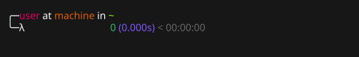
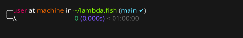
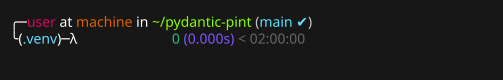

# Lambda.fish

A nice theme for Fish shell.
Originally based on [netologist/theme-lambda](https://github.com/netologist/theme-lambda).

To install this theme, use [promptswap.fish](https://github.com/tylerh111/promptswap.fish).

```bash
fisher install tylerh111/promptswap.fish
fisher install tylerh111/lambda.fish
promptswap choose lambda
```

Here's a look:

<p align="center"></p>
<p align="center"></p>
<p align="center"></p>
